<p align="center">
  <a href="https://github.com/eshaan-eshaan/MOTION-GRAPHICS/releases/download/v1.0.0/Indian-Astronomy-1080p.mp4">
    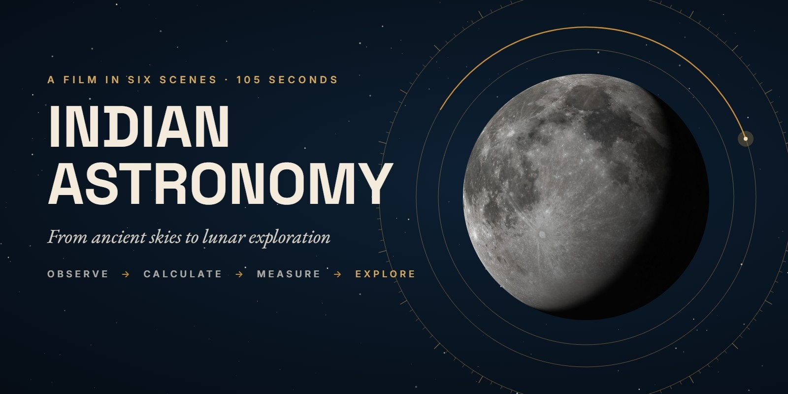
  </a>
</p>

<p align="center">
  <a href="https://github.com/eshaan-eshaan/MOTION-GRAPHICS/releases/download/v1.0.0/Indian-Astronomy-1080p.mp4"></a>
  
  
  
</p>
<p align="center">
  
  
  
  
  
</p>

<p align="center">
  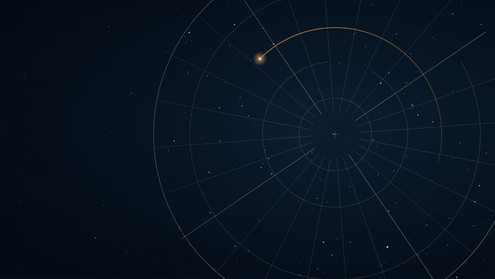
</p>
<p align="center"><sub>A 21-second highlight reel cut from the final render. The full film: <a href="https://github.com/eshaan-eshaan/MOTION-GRAPHICS/releases/download/v1.0.0/Indian-Astronomy-1080p.mp4">download it (1080p, 79 MB)</a> or open <a href="IndianAstronomy.mp4"><code>IndianAstronomy.mp4</code></a> in this folder.</sub></p>

---

## The film

A 105-second educational motion-design film for college students, in Hinglish. It tells one connected story:

<p align="center"><b>OBSERVE → CALCULATE → MEASURE → EXPLORE → REFLECT</b><br><i>From observing the heavens to exploring them.</i></p>

It doesn't claim that modern Indian spaceflight descends directly from ancient astronomy. Each era is shown as a different way of asking the same question. Every match cut carries a real piece of geometry from one scene into the next:

> Capella's **diurnal arc** → the **ecliptic** → a **calendar wheel** → a **jyā circle** → the **Earth** → a **shadow tangent** → the **Samrat Yantra's gnomon** → its **graduated arc** → the **Moon**

## Six scenes

<table>
<tr>
<td width="33%">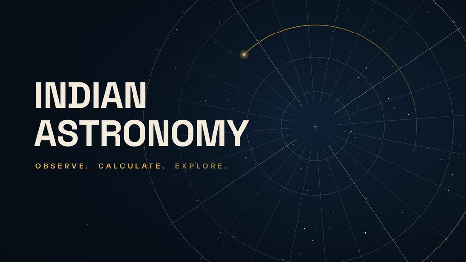<br><b>01 · The Question</b> <sub>0:00</sub><br><sub>Real stars turn around the north celestial pole. Capella traces its diurnal circle, which becomes a polar sky chart. The title builds itself out of dots that spiral from the pole.</sub></td>
<td width="33%">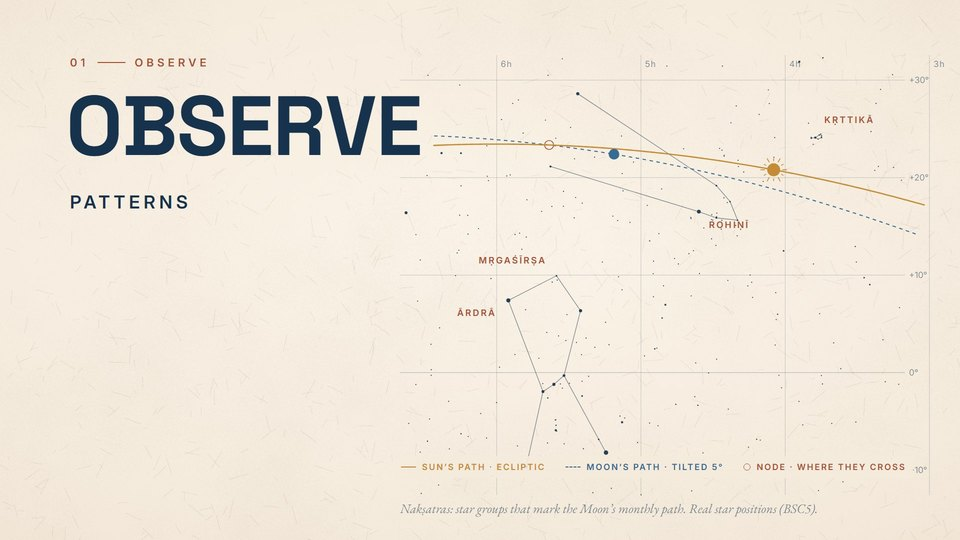<br><b>02 · Observe</b> <sub>0:09</sub><br><sub>An ivory chart of the real Taurus–Orion field: the ecliptic, the Moon's 5°-tilted path, the nodes and four nakshatras.</sub></td>
<td width="33%">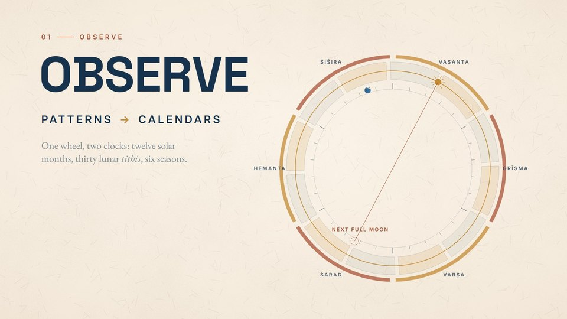<br><b>02 · Patterns → Calendars</b><br><sub>The ecliptic wraps into a wheel of 12 solar months, 30 lunar tithis and six ṛtus, and predicts the next full moon.</sub></td>
</tr>
<tr>
<td>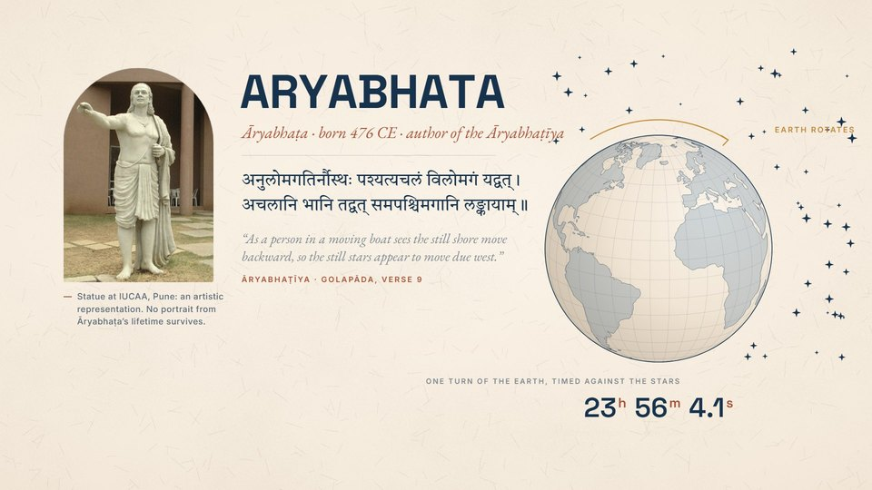<br><b>03 · Calculate</b> <sub>0:25</sub><br><sub>Āryabhaṭa: a statue labelled as an artistic representation, his boat verse (Golapāda 9) and the 23ʰ 56ᵐ 4.1ˢ sidereal day. His own jyā table draws itself as the sine curve.</sub></td>
<td>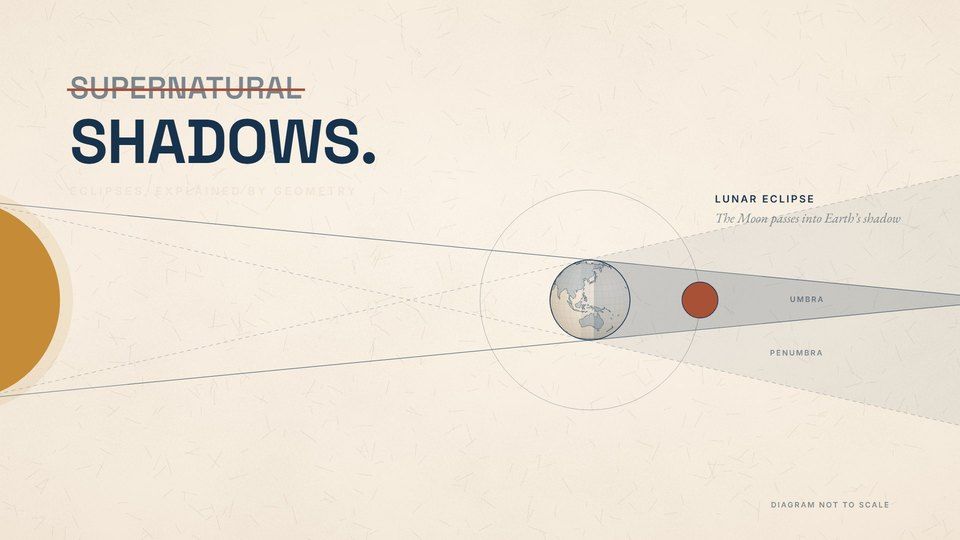<br><b>03 · Shadows, not the supernatural</b><br><sub>Lunar and solar eclipses drawn with true tangents to both circles. The diagram says it is not to scale.</sub></td>
<td>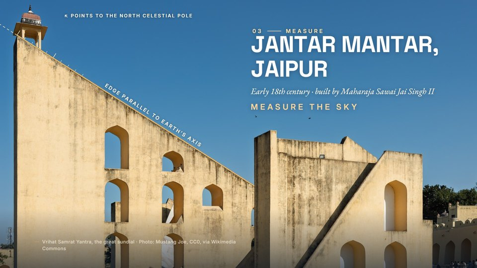<br><b>04 · Measure</b> <sub>0:42</sub><br><sub>Jantar Mantar, Jaipur. The gold line sits on the gnomon edge as measured in the photo; the edge points to the celestial pole.</sub></td>
</tr>
<tr>
<td>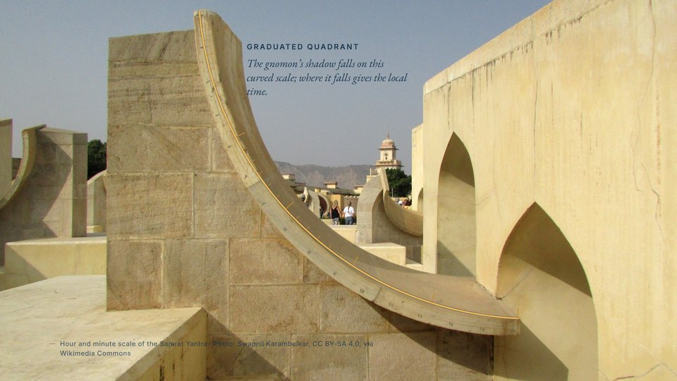<br><b>04 · The graduated quadrant</b><br><sub>A circle fitted to the real stone arc closes and becomes the outline of the Moon.</sub></td>
<td>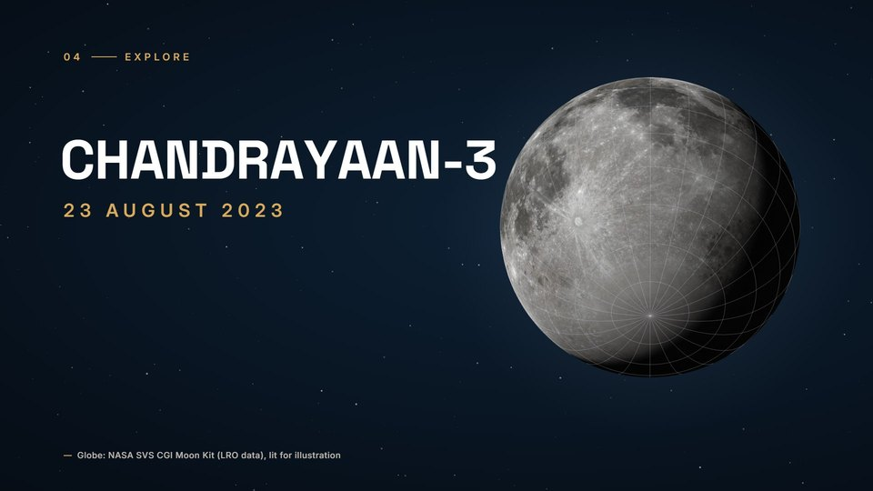<br><b>05 · Explore</b> <sub>0:56</sub><br><sub>The Earth–Moon distance rolls up beside an ink Moon traced from NASA LRO data, which becomes a lit globe. Impact: CHANDRAYAAN-3, 23 August 2023, landing near (not at) the south pole.</sub></td>
<td>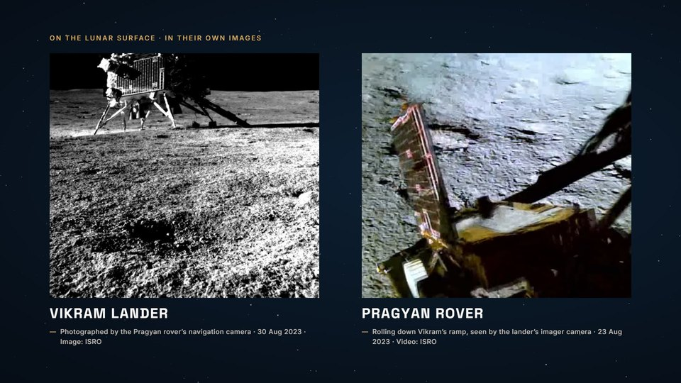<br><b>05 · Vikram &amp; Pragyan</b><br><sub>The lander and rover in ISRO's own images and footage, each with its source caption.</sub></td>
</tr>
<tr>
<td>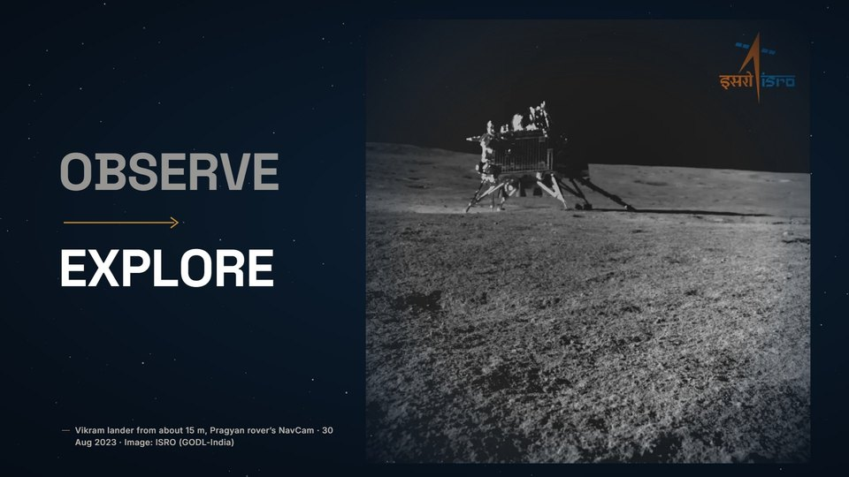<br><b>05 · Observe → Explore</b><br><sub>A hold on Vikram, photographed by Pragyan's NavCam from about 15 m.</sub></td>
<td>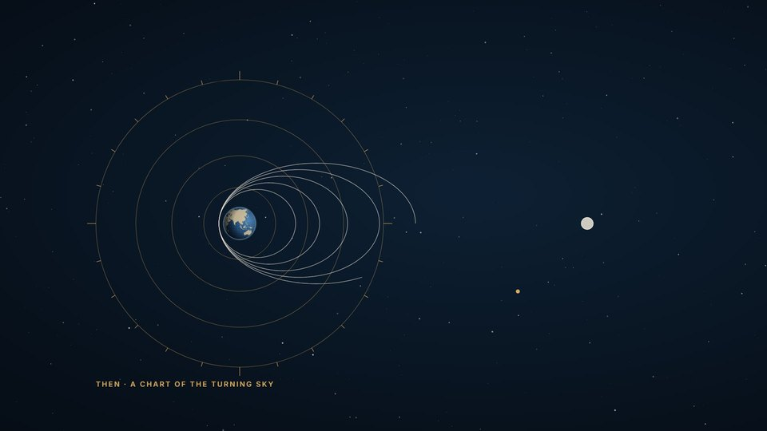<br><b>06 · Reflect</b> <sub>1:23</sub><br><sub>A 3D chart of ISRO's orbital launches per decade rises on "tools changed". Then the opening sky chart lines up around Earth with Chandrayaan-3's route.</sub></td>
<td>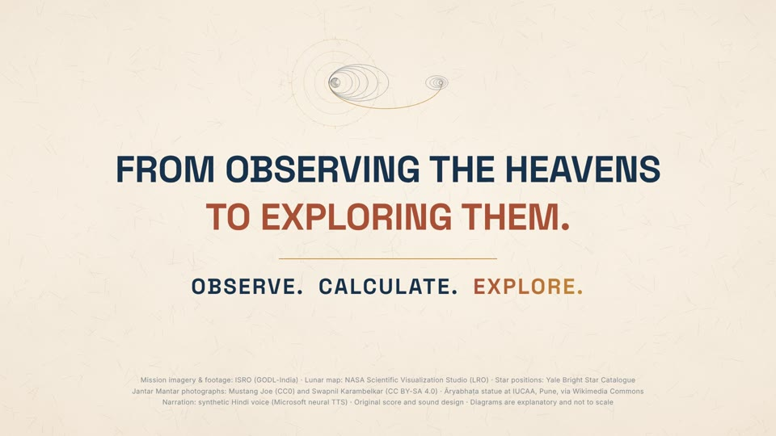<br><b>06 · End card</b><br><sub>The route becomes an emblem. <i>Observe. Calculate. Explore.</i> slam in, each on its spoken word, with the last in a terracotta-to-gold gradient.</sub></td>
</tr>
</table>

## Built to be correct

| Claim on screen | How it's grounded |
|---|---|
| Star charts | Real positions from the **Yale Bright Star Catalogue** (J2000). The ecliptic and the Moon's 5.145° path are computed, not drawn by hand. The dotted title sits on a strict grid with uniform dots, so it reads as type and never as stars |
| Capella's arc | An azimuthal projection about the north celestial pole. The whole sky turns as the Earth rotates |
| Āryabhaṭa | No portrait from his lifetime exists, so the IUCAA statue is **labelled as an artistic representation**. The verse is quoted in Devanagari with a translation. The jyā line plots his 24 tabulated values exactly (Gītikāpada 12; they sum to R = 3438′) |
| Eclipses | Umbra and penumbra are exact external and internal tangents. Sizes are chosen so both eclipse types work, and the diagram is marked **not to scale** |
| Samrat Yantra | The gold line is a line fitted to the gnomon edge in the CC0 photograph (`y = 0.6362x − 12.2`). Its ≈27° tilt is Jaipur's latitude, which is a property of the instrument's geometry |
| Jantar Mantar | "Early 18th century, built by Maharaja Sawai Jai Singh II". Not called ancient or Vedic |
| Chandrayaan-3 | Soft landing 23 Aug 2023 at **69.37° S, 32.32° E**, *near* the south polar region, not at the pole. Vikram and Pragyan are labelled separately |
| Launch chart | Bars are counted in code from a flight-by-flight list of all 100 ISRO orbital launch attempts, 1979–2025 ([`isroLaunches.json`](src/data/isroLaunches.json)). Failures included. The partial 2020s bar is marked. Values are labelled on the bars, with no 3D grid that would misread |
| Mission imagery | ISRO's own photos and footage, uncomposited and captioned with source and date. No invented telemetry or interfaces |

## Under the hood

- **One timing source.** [`src/data/cues.json`](src/data/cues.json) drives the React scenes and the Python score generator, so picture, voice, music and SFX can't drift apart.
- **Word-level sync.** Each narration line carries measured word boundaries ([`vo-timing.json`](public/audio/vo/vo-timing.json)). Reveals are keyed to spoken words, for example `cue("chandrayaan", "s5b", 6)` for "south".
- **A per-pixel Moon.** [`MoonGlobe`](src/components/MoonGlobe.tsx) ray-casts a sphere on a canvas from NASA's LRO colour map. An ink map is sampled through the same projection, so the drawn diagram turns into the lit globe without a seam. A d3 orthographic overlay places the graticule and landing site in the same frame.
- **Measured match cuts.** [`handoffs.ts`](src/scenes/handoffs.ts) holds the geometry each cut shares, including the gnomon line and the quadrant circle, both fitted in the actual photographs.
- **Custom transition.** An iris from the celestial pole ([`SceneTransition.tsx`](src/components/SceneTransition.tsx)) turns the night sky into paper, ink-side out.
- **The score is code.** [`tools/compose_score.py`](tools/compose_score.py) synthesises the score: a tanpura with a jawari-style moving formant, a santoor-like ostinato, string pads in D Yaman (Lydian), frame drums and a closing bansuri phrase. Its biggest swell lands exactly on the Chandrayaan-3 title.
- **Mix.** The score ducks about 10 dB under every spoken line and opens up for the impact. The master comes out at −16.1 LUFS with a true peak of −1.1 dBTP.

## Design system

<p align="center">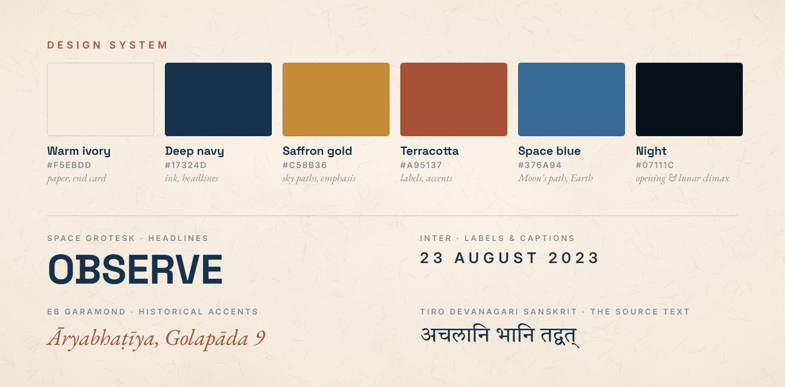</p>

Bright editorial paper for most of the film. Deep space appears only at the opening and in the lunar climax. Motion is frame-driven: well-damped springs, `bezier(0.16, 1, 0.3, 1)` ease-outs, and no decorative particles.

## Run it

```bash
npm i
```

```bash
npx remotion studio
```

The composition is **IndianAstronomy**. Each scene is also registered under *Scenes/*, and the README art is under *Repo/*.

```bash
npm run render
```

That writes `out/IndianAstronomy.mp4` (H.264 CRF 16, AAC 320 kbps). On Windows, a very long project path can push Remotion's bundled Chrome past the 260-character limit. [`remotion.config.ts`](remotion.config.ts) falls back to a copy at `%LOCALAPPDATA%\remotion-chs\` when one exists.

| Command | What it does |
|---|---|
| `npm run audio` | Regenerates the narration (TTS), loudness-normalises it, and composes the score and SFX |
| `npm run textures` | Rebuilds the resized photos, the paper grain, the ink Moon map and the star subsets |
| `node tools/stills.mjs <Comp> <frames…>` | Renders QA stills from a single bundle |
| `python -I tools/transcribe_vo.py` | Whisper transcription of every line, compared with the script |

<details>
<summary><b>Project structure</b></summary>

```
src/
  IndianAstronomy.tsx     root: TransitionSeries of six scenes + AudioMix
  timeline.ts             scene timing, narration cues, word lookups
  data/cues.json          single source of truth for timing (shared with Python)
  data/stars.json         BSC5 star subsets
  data/isroLaunches.json  every ISRO orbital launch attempt, 1979–2025 (Scene 6 chart)
  data/jyaTable.json      Āryabhaṭa's 24 sine differences (Scene 3 line)
  scenes/                 OpeningScene … ClosingScene, handoffs.ts
  components/             PolarChart, MoonGlobe, MoonOverlay, EarthGlobe, GrowthChart, PixelTitle, LineDraw, NumberRoll, Type, Icons, SceneTransition
  audio/AudioMix.tsx      narration, ducked score, cue-locked SFX
  repo/RepoStills.tsx     banners and design sheet for this README
public/                   fonts (OFL), images, video, audio: everything the render needs, local only
tools/                    asset download, TTS, score synthesis, textures, QA scripts
docs/                     narration script and asset manifest
assets-src/research/      Wikimedia Commons metadata snapshots for every source file
```
</details>

## Script, sources and licences

- **[Narration script](docs/NARRATION_SCRIPT.md):** all 14 Hinglish lines with exact timing, the Devanagari TTS input, on-screen text and the factual sources.
- **[Asset manifest](docs/ASSET_MANIFEST.md):** every image, video, map, dataset, font and sound, with its author, licence and any changes made.

**Credits.**
- Mission imagery and footage: **ISRO** (GODL-India).
- Lunar map: **NASA Scientific Visualization Studio** (LRO).
- Star positions: Yale Bright Star Catalogue.
- Jantar Mantar photographs: Mustang Joe (CC0) and Swapnil Karambelkar (CC BY-SA 4.0).
- Āryabhaṭa statue at IUCAA, Pune, via Wikimedia Commons.
- Fonts: Space Grotesk, Inter, EB Garamond and Tiro Devanagari Sanskrit (SIL OFL).

The narration is a **synthetic voice** (Microsoft neural TTS, `hi-IN-SwaraNeural`), and the score and sound design are original, generated in code.

<details>
<summary><b>QA notes</b></summary>

**Checked**

- **Export:** 105.003 s, 3,150 frames, 1920 × 1080, 30 fps, H.264 at about 6 Mb/s, AAC 48 kHz.
- **Audio:** −16.1 LUFS, true peak about −1.1 dBTP, no clipping. Narration sits about 11 dB above the score.
- **Narration:** all 14 lines were transcribed with Whisper and match the script. The date is spoken as "तेईस अगस्त दो हज़ार तेईस".
- **Picture:** frames were checked across all six scenes and at every cut. Nothing is clipped, and every authentic image carries its source caption.

**Known limits**

- **Voice:** it is synthetic. Check Microsoft's terms before commercial use, or re-voice.
- **Music:** it was verified by measurement and spectrogram, not by a human listen.
- **LPDC footage:** ISRO's source is 1080 px tall, so the full-frame crop is slightly soft.
- **Quadrant photo:** it is CC BY-SA 4.0.
</details>
