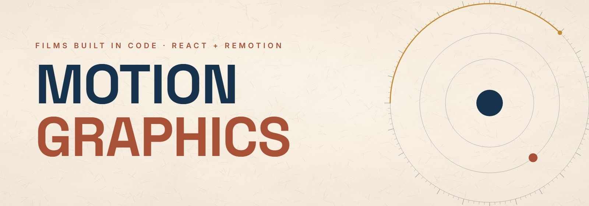
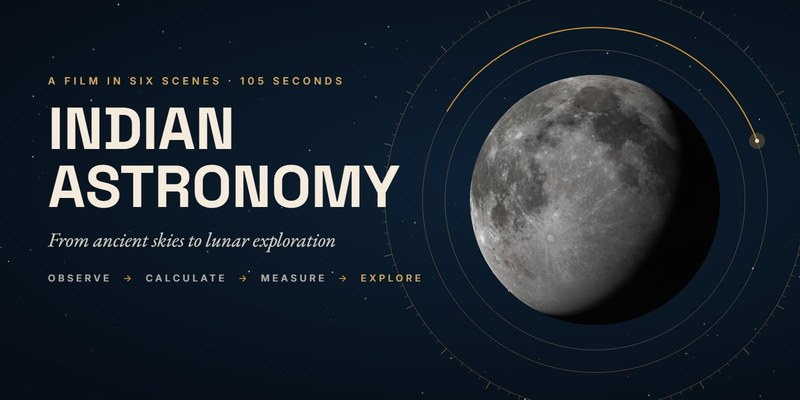

<p align="center">
  
</p>

<p align="center">
  Motion-design films written as code: every frame is a function of time.<br>
  <sub>React · Remotion · TypeScript · d3-geo · procedural audio</sub>
</p>

<p align="center">
  <a href="./Indian%20Astronomy%20Video/"></a>
  <a href="https://github.com/eshaan-eshaan/MOTION-GRAPHICS/releases"></a>
  
</p>

---

## Films

<table>
<tr>
<td width="46%">
  <a href="./Indian%20Astronomy%20Video/"></a>
</td>
<td>

### [Indian Astronomy](./Indian%20Astronomy%20Video/)
*From Ancient Skies to Lunar Exploration*

A 105-second educational film in Hinglish. It goes from a star tracing its arc around the
celestial pole, through Āryabhaṭa and the Jantar Mantar, to Chandrayaan-3's landing near the
Moon's south polar region.

**OBSERVE → CALCULATE → MEASURE → EXPLORE → REFLECT**

`1920×1080` · `30 fps` · `105 s` · real star catalogue · ISRO mission imagery · original score

[▶ Watch (1080p MP4)](https://github.com/eshaan-eshaan/MOTION-GRAPHICS/releases/download/v1.0.0/Indian-Astronomy-1080p.mp4) ·
[Source](./Indian%20Astronomy%20Video/) ·
[Script](./Indian%20Astronomy%20Video/docs/NARRATION_SCRIPT.md) ·
[Sources &amp; licences](./Indian%20Astronomy%20Video/docs/ASSET_MANIFEST.md)

</td>
</tr>
</table>

<p align="center">
  <a href="./Indian%20Astronomy%20Video/"></a>
</p>

## How these films are made

| | |
|---|---|
| **Frame-driven** | No CSS animation. Every movement is a pure function of the frame number, so renders are deterministic and can be edited in Remotion Studio. |
| **One timing source** | A single cue file drives scenes, narration placement, the music generator and the sound effects. Voice-over reveals are keyed to measured word timings. |
| **Real data, honestly labelled** | Star catalogues, lunar maps and mission imagery are used as they are and captioned with their source. Illustrations and schematics say what they are. |
| **Sound from code** | The score and SFX are synthesised in Python and locked to the same cue grid, so the musical payoff lands on the frame it's meant to. |
| **Rendered locally** | Fonts, images, video and audio all ship with each project. Rendering makes no network requests. |

## Repository layout

```
MOTION-GRAPHICS/
├── README.md
├── media/                        art for this page
└── Indian Astronomy Video/       a complete Remotion project and its final render
    ├── IndianAstronomy.mp4
    ├── README.md                 scenes, gallery, accuracy notes, how to render
    ├── src/  public/  tools/  docs/
    └── media/                    banner, highlight reel, gallery
```

Each film lives in its own folder as a self-contained Remotion project: `npm i`, then `npx remotion studio`.

## Licences

The code is published here for viewing and learning, and no open-source licence has been chosen
yet. Third-party imagery, data and fonts keep their own licences (ISRO GODL-India, NASA, CC0,
CC BY-SA 4.0, SIL OFL). Each film's asset manifest lists them.
